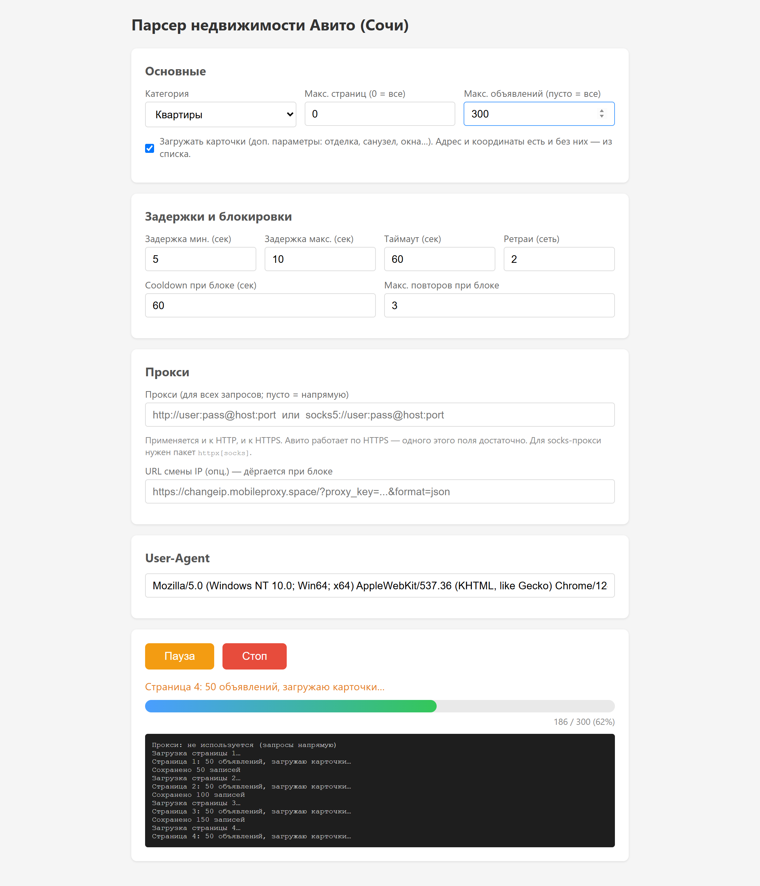

# Парсер Авито

Собирает объявления о продаже недвижимости в Сочи: квартиры, комнаты, дома, участки, гаражи, коммерческую. Работает без браузера, обычными запросами. Со страницы выдачи берёт JSON, который Авито кладёт прямо в HTML, а потом по каждому объявлению догружает карточку с точным адресом и параметрами вроде отделки, санузла и окон. Всё складывается в JSON.



Управлять можно со странички в браузере: выбрал категорию, лимиты, прокси, нажал старт и смотришь прогресс. Можно поставить на паузу, поменять настройки и продолжить с того же места. Или запускать из консоли.

Авито быстро начинает отвечать 429, без прокси далеко не уехать. Парсер это видит: ждёт, может дёрнуть ссылку смены IP у мобильного прокси и пробует снова.

## Запуск

```
pip install -r requirements.txt
cp .env.example .env
python web.py
```

Страница откроется на http://127.0.0.1:8000.

Из консоли:

```
python main.py --category kvartiry --max-pages 3
python main.py --list-categories
```

Тесты парсеров на примерах страниц, без сети: `python -m pytest tests`

Python, httpx, BeautifulSoup, FastAPI.
